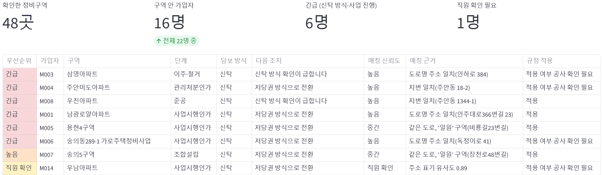
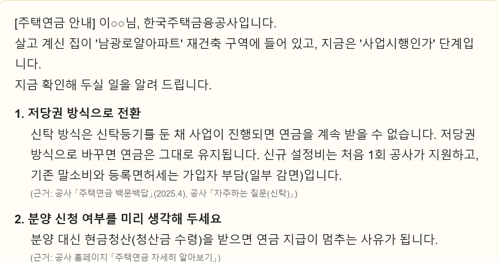

# 재건축 알림이 (시연용 시제품)

정비사업 공공데이터로 재건축·재개발 구역 안의 주택연금 가입자를 찾아, 사업 단계마다 해야 할 일을 먼저 안내하는 서비스의 시제품입니다. 2026년 HF 대국민 혁신 아이디어 공모전 제안 「재건축 알림이」의 작동 방식을 보여 주기 위해 만들었습니다.

## 무엇을 보여 주나
- **직원 현황판:** 정비구역 안 가입자를 우선순위(신탁 방식이면서 사업이 진행 중인 건 먼저)로 정렬하고, 주소가 비슷하기만 한 건은 "직원 확인"으로 분류합니다.
- **가입자 안내문:** 사업 단계와 담보 방식에 맞는 안내를 큰 글씨로 만들고, 항목마다 근거 규정을 표시합니다.
- **정비사업 현황:** 공공데이터의 인가 일자와 추진사항으로 구역별 현재 단계를 판단합니다.
- **안내 규칙표:** 판단 기준을 공개합니다. 안내문은 규칙표가 고른 내용만 씁니다.





화면의 정비사업 현황은 실제 공공데이터이고, 가입자는 모두 가상입니다.

## 데이터
| 데이터 | 출처 | 비고 |
|---|---|---|
| `data/michuhol_redevelopment.csv` | 공공데이터포털 「인천광역시 미추홀구_정비사업 추진현황」(2026-07-28 수정, 이용허락 제한 없음) | 실제 공공데이터, 48개 사업 |
| `data/members_synthetic.csv` | `make_members.py`로 생성 | **가상 데이터.** 실제 가입자 정보가 아님 |

## 실행
```bash
pip install -r requirements.txt
python make_members.py      # 가상 가입자 생성
python -m unittest discover -s tests
streamlit run app.py
```

## 한계와 실제 도입 시 보완점
- 정비구역 위치가 "○○로 ○번길 일원"처럼 넓게 적혀 있어, 시제품은 도로명·지번 일치와 표기 유사도로 매칭합니다. 실제 도입 시에는 행정안전부 주소정보 API로 주소를 좌표·건물번호로 바꾸고 정비구역 경계(필지 목록)와 대조해야 합니다.
- 소규모주택정비사업은 주택연금 재건축 규정 적용 여부를 공사가 확인해야 해 "확인 필요"로 표시합니다.
- 안내 규칙은 공사 홈페이지 안내, 자주하는 질문(신탁), 주택연금 백문백답(2025.4), 한국주택금융공사법 시행령 제3조의2를 근거로 했으며, 운영 전 공사 담당 부서의 검토가 필요합니다.

## AI 활용 내역
- **개발:** 코드 초안 작성과 정리에 AI 코딩 도구(Claude Code)를 보조로 썼습니다. 주제와 규칙 설계, 데이터 선택, 근거 확인과 검증(단위 테스트 11개), 결과 판단은 제안자가 직접 했습니다.
- **서비스 안의 AI:** 시제품의 안내문은 규칙 기반이며 LLM 없이 동작합니다. `ANTHROPIC_API_KEY`가 설정된 경우에만 `ai_polish.py`가 Claude(claude-opus-5-5)로 문장을 쉽게 다듬으며, 새 사실을 더하지 않도록 지시합니다. 시연은 키 없이 규칙 기반으로 진행했고, 이 선택 기능은 키가 없어 실제 호출로 검증하지 못했습니다.

## 라이선스
코드는 MIT 라이선스입니다. `data/michuhol_redevelopment.csv`는 공공데이터포털에서 받은 원본(이용허락 제한 없음)입니다.
